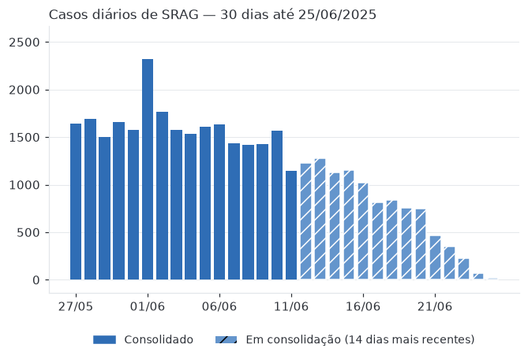
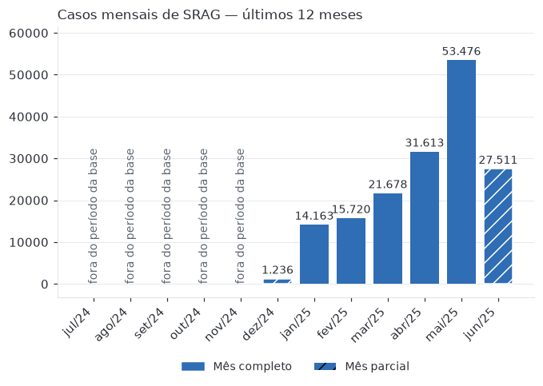

# Relatório de SRAG — Brasil

Dados até **25/06/2025** (Open DATASUS, SIVEP-Gripe) · gerado em 18/10/2026 · situação: **concluído**

## Resumo

No período de 29 de maio a 11 de junho de 2025, houve uma queda de 14,3% na taxa de casos de Síndrome Respiratória Aguda Grave (SRAG) no Brasil, apesar de um aumento de 28,6% nos 30 dias consolidados anteriores. A taxa de mortalidade por SRAG no período de dezembro de 2024 a junho de 2025 foi de 8,0%. A proporção de casos internados em UTI foi de 29,4%, e a taxa de vacinação contra COVID-19 entre os casos internados foi de 76,1%, com 32,1% vacinados contra a gripe. A maior parte dos casos permanece sem especificação do agente etiológico.

## Métricas

| Métrica | Valor | Base | Período |
|---|---:|---|---|
| Taxa de aumento de casos | −14,3% | 10.224 casos contra 11.928 na semana anterior; 30 dias consolidados: 51.268 contra 39.878 nos 30 anteriores (+28,6%) | 29/05/2025 a 11/06/2025 |
| Taxa de mortalidade | 8,0% | 9.885 de 124.188 | 29/12/2024 a 25/06/2025 |
| Taxa de internação em UTI | 29,4% | 42.519 de 144.540 | 29/12/2024 a 25/06/2025 |
| Taxa de vacinação contra COVID-19 entre os casos | 76,1% | 124.808 de 164.025; gripe: 32,1% (48.055 de 149.529) | 29/12/2024 a 25/06/2025 |

- **Taxa de aumento de casos.** A taxa de aumento de casos entre 29 de maio e 11 de junho de 2025 foi de queda de 14,3%, indicando redução recente nos casos de SRAG. Contudo, a variação nos 30 dias consolidados até 11 de junho mostra alta de 28,6%, sinalizando aumento em período anterior. Esse cenário é consistente com relatos de alerta para quadros graves de infecções respiratórias no país [1]. *Limitação: Os 14 dias mais recentes ficam de fora porque ainda recebem notificações atrasadas; incluí-los mostraria uma queda que não aconteceu.*
- **Taxa de mortalidade.** A taxa de mortalidade por SRAG no Brasil, considerando o período de 29 de dezembro de 2024 a 25 de junho de 2025, foi de 8,0%. Esse indicador reflete os óbitos entre casos com desfecho conhecido, conforme definido na base de dados. O estado do Rio de Janeiro, por exemplo, registrou 676 mortes até junho de 2025 [2]. *Limitação: Casos ainda sem desfecho ou com desfecho ignorado ficam fora do denominador.*
- **Taxa de internação em UTI.** A taxa de internação em UTI entre os casos de SRAG com informação disponível foi de 29,4% no período de 29 de dezembro de 2024 a 25 de junho de 2025. Essa métrica representa a proporção de casos internados em UTI, não a ocupação de leitos, que depende de dados adicionais do CNES. *Limitação: Não é a taxa de ocupação de leitos: a base não traz a capacidade de UTI. A ocupação real exigiria cruzar com o cadastro de leitos do CNES.*
- **Taxa de vacinação contra COVID-19 entre os casos.** A taxa de vacinação contra COVID-19 entre os casos internados por SRAG foi de 76,1% no período de 29 de dezembro de 2024 a 25 de junho de 2025. Além disso, 32,1% dos internados receberam vacina contra a gripe. Esses dados indicam cobertura vacinal significativa entre os casos graves, embora não representem a cobertura vacinal da população geral. *Limitação: Mede a vacinação entre os internados por SRAG, não a cobertura vacinal da população.*

## Evolução dos casos

*Últimos 30 dias até a data de referência. Os 14 dias mais recentes ainda estão em consolidação (notificações atrasadas). Contagens de 1 a 4 aparecem como "<5". Quando há alguma, a menor contagem exibida também aparece como "oculto" (supressão complementar): sem isso, o total menos as demais revelaria o valor escondido. O total é exato e inclui as células escondidas. Aqui o oculto fica no mesmo trecho do valor escondido (cada semana do aumento de casos, os dias em consolidação, cada mês), porque a soma desses trechos também é publicada.*

*Últimos 12 meses até a data de referência. Meses anteriores ao início da base aparecem sem dados; o primeiro e o último mês podem estar incompletos. Contagens de 1 a 4 aparecem como "<5". Quando há alguma, a menor contagem exibida também aparece como "oculto" (supressão complementar): sem isso, o total menos as demais revelaria o valor escondido. O total é exato e inclui as células escondidas. O mês que cabe inteiro na série diária nunca é o oculto: as barras diárias o revelariam.*

## Perfil dos casos — por agente causador

| Categoria | Casos | % |
|---|---:|---:|
| Não especificado | 61.256 | 37,0% |
| Outro vírus respiratório | 46.269 | 28,0% |
| Influenza | 24.874 | 15,0% |
| Em investigação | 22.748 | 13,8% |
| COVID-19 | 8.312 | 5,0% |
| Outro agente | 1.938 | 1,2% |

*Total: 165.397. Contagens de 1 a 4 aparecem como "<5". Quando há alguma, a menor contagem exibida também aparece como "oculto" (supressão complementar): sem isso, o total menos as demais revelaria o valor escondido. O total é exato e inclui as células escondidas.*

## Contexto do período dos dados

No período dos dados, de 29 de maio a 11 de junho de 2025, houve uma queda recente de 14,3% nos casos de SRAG, mas a variação consolidada dos 30 dias anteriores indica aumento de 28,6% nos casos. O país enfrentava alerta para quadros graves de gripe e COVID-19, com aumento de casos por influenza A e vírus sincicial respiratório em várias regiões [1]. O estado do Rio de Janeiro, por exemplo, apresentava desaceleração nas internações, mas ainda com números elevados e 676 mortes registradas até junho de 2025 [2]. A SRAG é causada por diversos agentes, incluindo vírus influenza e coronavírus [3].

## Cenário atual (notícias recentes)

No cenário atual, em outubro de 2026, os casos de SRAG por rinovírus, metapneumovírus e SARS-CoV-2 apresentam tendência de alta no Brasil, enquanto os casos por vírus sincicial respiratório e influenza B estão em queda. Os novos registros semanais de SRAG por COVID-19 permanecem baixos. Algumas capitais, como Aracaju, Porto Alegre, Rio Branco, São Luís e Vitória, apresentam aumento da atividade da SRAG \[4\]\[5\][6]. O boletim InfoGripe indica estabilização ou oscilação dos casos no país, com Sergipe em alerta para crescimento da incidência [7].

## Limitações

As taxas apresentadas consideram apenas casos com informações completas, excluindo casos sem desfecho conhecido ou sem dados sobre internação em UTI e vacinação. A taxa de internação em UTI refere-se à proporção de casos internados em UTI, não à ocupação de leitos hospitalares. A vacinação é medida entre os internados por SRAG, não refletindo a cobertura vacinal da população geral. Os 14 dias mais recentes dos dados ainda estão em consolidação e podem sofrer alterações com notificações atrasadas.

## Referências

1. [Brasil está em alerta de risco para quadros graves de gripe e Covid-19 | CNN Brasil](<https://www.cnnbrasil.com.br/nacional/brasil/brasil-esta-em-alerta-de-risco-para-quadros-graves-de-gripe-e-covid-19>) — www\.cnnbrasil.com.br, 05/06/2025 (período dos dados)
2. [Síndrome Respiratória Aguda Grave já matou 676 pessoas este ano no Rio | Agência Brasil](<https://agenciabrasil.ebc.com.br/saude/noticia/2025-06/sindrome-respiratoria-aguda-grave-ja-matou-676-pessoas-este-ano-no-rio>) — agenciabrasil.ebc.com.br, 18/06/2025 (período dos dados)
3. [Casos de Síndrome Respiratória Aguda Grave disparam no Brasil | CNN Brasil](<https://www.cnnbrasil.com.br/nacional/brasil/casos-de-sindrome-respiratoria-aguda-grave-disparam-no-brasil>) — www\.cnnbrasil.com.br, 29/05/2025 (período dos dados)
4. [Vírus respiratórios ainda estão em alta no país, alerta Fiocruz | Agência Brasil](<https://agenciabrasil.ebc.com.br/saude/noticia/2026-10/virus-respiratorios-ainda-estao-em-alta-no-pais-alerta-fiocruz>) — agenciabrasil.ebc.com.br, 08/10/2026 (cenário atual)
5. [País registra tendência de alta de casos de síndrome respiratória | Radioagência Nacional](<https://agenciabrasil.ebc.com.br/radioagencia-nacional/saude/audio/2026-10/pais-registra-tendencia-de-alta-de-casos-de-sindrome-respiratoria>) — agenciabrasil.ebc.com.br, 09/10/2026 (cenário atual)
6. [Fiocruz alerta para aumento de vírus respiratórios no Brasil - Portal 98 FM Natal](<https://98fmnatal.com.br/destaque_mais/fiocruz-aumento-virus-respiratorios-srag-brasil/400372>) — 98fmnatal.com.br, 08/10/2026 (cenário atual)
7. [SRAG no Brasil mantém estabilidade, mas Sergipe segue em alerta - Portal Afya](<https://portal.afya.com.br/infectologia/srag-no-brasil-mantem-estabilidade-mas-sergipe-segue-em-alerta>) — portal.afya.com.br, 17/10/2026 (cenário atual)

---

## Como este relatório foi gerado

Modelo openrouter / openai/gpt-4.1-mini · 15.976 de entrada e 1.476 de saída · custo estimado US$ 0,0088 · código 0690ea3 · prompts 388e449de8228eb1

Os números das tabelas e dos gráficos vêm de SQL na camada gold. O texto foi escrito pelo modelo e conferido automaticamente (números, citações, links, dados pessoais). A trilha completa está em `auditoria.jsonl` e na tabela `auditoria.eventos`.

| # | Etapa | Tipo | Ferramenta | Motivo / resultado | ms |
|--:|---|---|---|---|--:|
| 1 | orquestrador | llm |  |  — modelo: openai/gpt-4.1-mini | 4728 |
| 2 | ferramentas | ferramenta | consultar_metricas | Coletar as 4 métricas principais para o relatório nacional de SRAG em 2026-10-18. | 35 |
| 3 | ferramentas | ferramenta | consultar_metricas | Coletar as 4 métricas principais para o relatório nacional de SRAG em 2026-10-18. | 50 |
| 4 | ferramentas | ferramenta | consultar_metricas | Coletar as 4 métricas principais para o relatório nacional de SRAG em 2026-10-18. | 53 |
| 5 | ferramentas | ferramenta | consultar_metricas | Coletar as 4 métricas principais para o relatório nacional de SRAG em 2026-10-18. | 51 |
| 6 | ferramentas | ferramenta | consultar_serie | Obter séries temporais para análise do cenário nacional de SRAG em 2026-10-18. | 32 |
| 7 | ferramentas | ferramenta | consultar_serie | Obter séries temporais para análise do cenário nacional de SRAG em 2026-10-18. | 33 |
| 8 | ferramentas | ferramenta | consultar_distribuicao | Analisar a distribuição dos casos de SRAG por agente causador para o relatório nacional em 2026-10-18. | 32 |
| 9 | ferramentas | ferramenta | buscar_noticias | Buscar notícias recentes para embasar o relatório nacional de SRAG no período dos dados até 2026-10-18. | 842 |
| 10 | ferramentas | ferramenta | buscar_noticias | Buscar notícias atuais para embasar o relatório nacional de SRAG no cenário atual até 2026-10-18. | 182 |
| 11 | orquestrador | llm |  |  — modelo: openai/gpt-4.1-mini | 1543 |
| 12 | verificar_cobertura | decisao |  |  |  |
| 13 | redator | llm |  |  — modelo: openai/gpt-4.1-mini | 6226 |
| 14 | guardrail_saida | guardrail |  |  — aprovado |  |

*Prova de conceito. Não substitui avaliação clínica nem boletim epidemiológico oficial.*